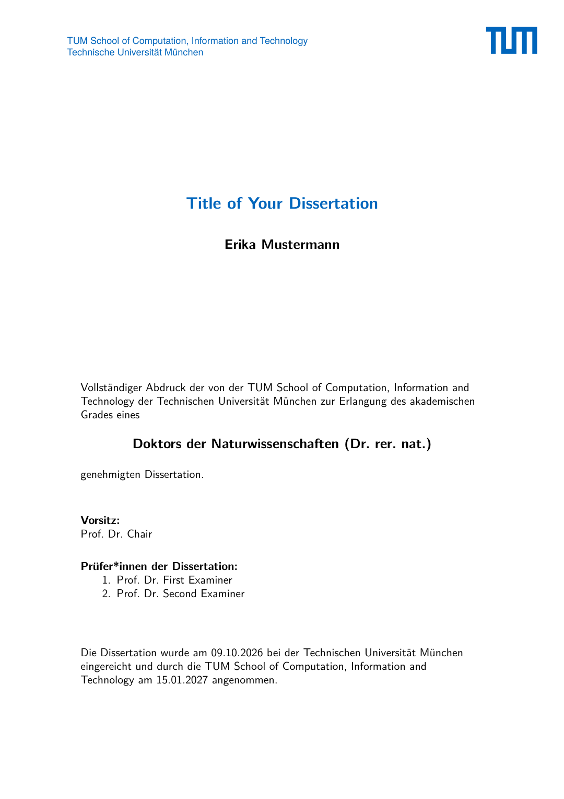
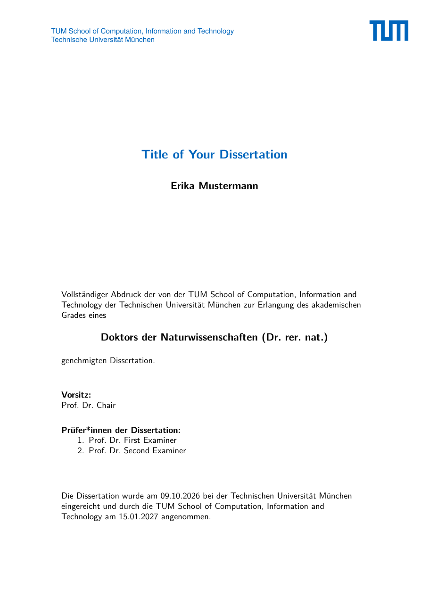
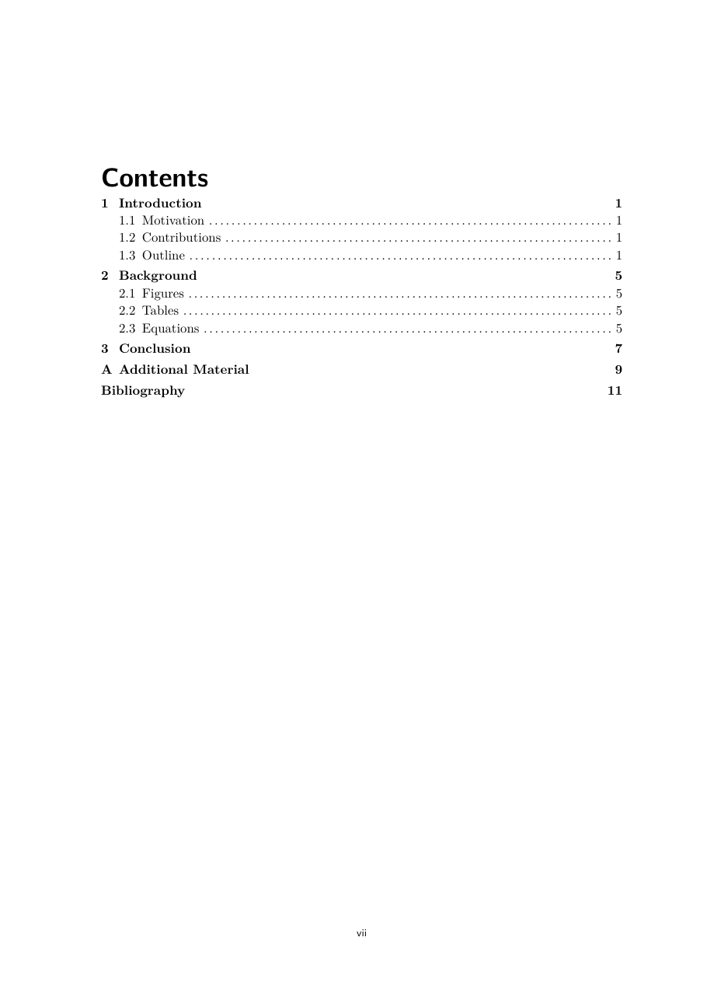
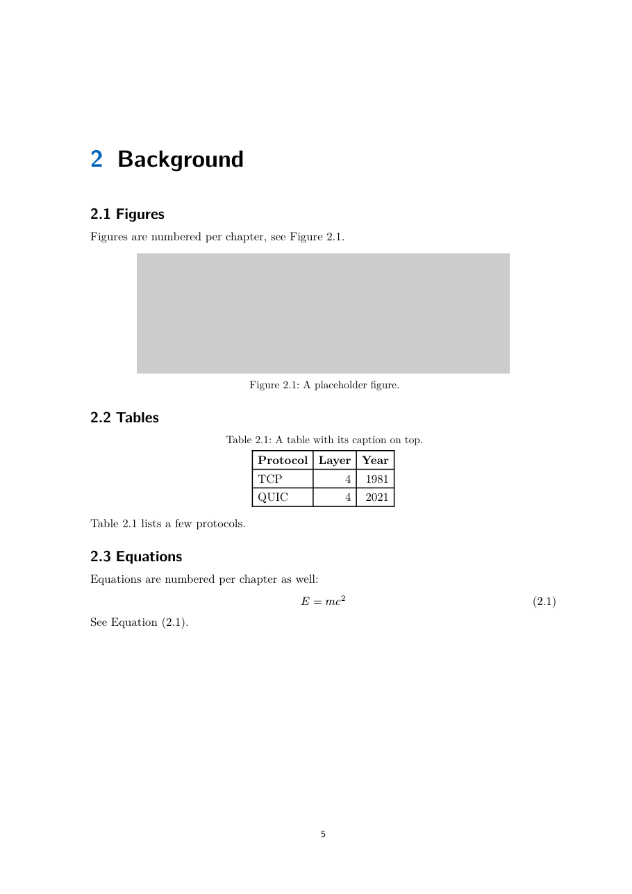

# typst-tum-dissertation

<p align="center">
  
</p>

Dissertations at the Technical University of Munich (TUM), with the cover page
TUM asks for when you submit. The cover is ported from the TUM LaTeX
dissertation template. Everything after it is a simple book layout you can
change as you like.

## Examples

| Cover | Contents | Chapter |
| --- | --- | --- |
|  |  |  |

## Usage

Click "Use this template" on GitHub and edit [`main.typ`](main.typ). Write
your chapters in [`chapters/`](chapters/), put images in
[`figures/`](figures/) and references in [`references.bib`](references.bib).
Everything the template needs but you should not touch lives in
[`tum-dissertation/`](tum-dissertation/).

```typ
#import "tum-dissertation/lib.typ": appendix, dissertation, tum-colors

#show: dissertation.with(
  title: [Title of Your Dissertation],
  author: "Erika Mustermann",
  school: "TUM School of Computation, Information and Technology",
  degree: "Doktors der Naturwissenschaften (Dr. rer. nat.)",
  examiners: ("Prof. Dr. First Examiner", none),
  abstract: include "chapters/abstract.typ",
  bibliography: bibliography("references.bib"),
)

#include "chapters/01-introduction.typ"
```

```sh
typst compile --font-path fonts main.typ
```

The cover needs New Computer Modern Sans and TeX Gyre Heros, which are not
built into Typst. They are in [`fonts/`](fonts/), so always pass
`--font-path fonts`. In the Typst web app, upload the `fonts/` folder together
with the rest of the project.

### Options

| Parameter | Default | Description |
| --- | --- | --- |
| `title` | `[]` | Shown on the cover and in the PDF metadata. |
| `author` | `""` | Shown on the cover and in the PDF metadata. |
| `school` | `"TUM School of Computation, Information and Technology"` | The TUM school awarding the degree. |
| `degree` | `"Doktors der Naturwissenschaften (Dr. rer. nat.)"` | e.g. `"Doktors der Ingenieurwissenschaften (Dr.-Ing.)"`. |
| `chair` | `none` | Chair of the committee (Vorsitz). `none` leaves the line empty. |
| `examiners` | `(none, none)` | Examiners in order. A `none` entry keeps its numbered line empty. |
| `submission-date`, `acceptance-date` | `none` | A `datetime`, e.g. `datetime(year: 2026, month: 10, day: 9)`. `none` leaves a gap to fill in by hand. |
| `lang` | `"en"` | Language of the main text. The cover is always German. |
| `twoside` | `false` | For printing. Chapters start on right-hand pages and the margins mirror. |
| `abstract`, `zusammenfassung`, `acknowledgements` | `none` | Front matter, left out if `none`. |
| `list-of-figures`, `list-of-tables` | `true` | Whether to print the lists. |
| `bibliography` | `none` | A `bibliography(...)` call, placed after the last chapter. |

### Layout helpers

- `= Heading` starts a new chapter. Figures, tables and equations are
  numbered per chapter (2.1, 2.2, ...).
- `#show: appendix` after the last chapter numbers the following chapters
  A, B, C, ...
- `tum-colors` holds the colors of the TUM Corporate Design Manual, e.g.
  `tum-colors.primary-blue` or `tum-colors.accent-orange`. The accent colors
  are meant for highlights only, not for backgrounds.

## How the cover was ported

Positions, font sizes and spacing were measured from a dissertation built with
the TUM LaTeX template and are within about a point of it. The LaTeX version
uses Latin Modern Sans and Helvetica, here New Computer Modern Sans and TeX
Gyre Heros stand in for them.

This is not an official TUM template. Check the current requirements of the
TUM Graduate School before you submit.

## Checking the layout

```sh
typst compile --root . --font-path fonts tests/twoside.typ
```

[`tests/twoside.typ`](tests/twoside.typ) builds the sample in print layout
with every cover field filled in, so you can check the blank pages between
chapters. [`tests/invalid-date.typ`](tests/invalid-date.typ) passes a string
as date and has to fail. The GitHub Actions build both, plus `main.typ`.

## License

The code is MIT licensed.

The TUM logo is not. The file `tum-dissertation/assets/tum-logo-blue.svg`
comes from the official TUM LaTeX template package, converted to SVG. The logo
is a trademark of the Technical University of Munich and all rights stay with
TUM. You may only use it as the TUM corporate design guidelines allow
(<https://www.tum.de/cd>), and the MIT License does not give you any right to
reuse, change or redistribute it. This also goes for the logo in the
thumbnail and the example previews.

The fonts in `fonts/` are under the GUST Font License, see
[`fonts/README.md`](fonts/README.md).
